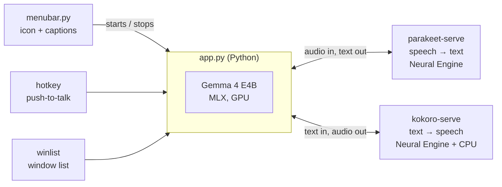

# Design

How the code fits together. The [README](../README.md) covers what the assistant does and how fast it is. This page is for reading the code.

## Processes and chips



The vision-language model is the only model on the GPU. Speech recognition and speech synthesis are separate Swift processes (`tools/parakeet`), built on FluidAudio and Core ML. They talk to the app over stdin and stdout, so audio never touches the disk. Each model has a chip to itself, so speech work never waits for the GPU.

`menubar.py` runs `app.py` in its own process group. Turning the assistant off ends the whole group, which frees its memory at once and deletes what it saw.

## Threads in the app

| Thread | Code | Job |
|---|---|---|
| Screen watcher | `screen.py` | A ScreenCaptureKit stream. A screen is read only when enough token-sized cells have changed and the screen has settled. Animated cells are ignored. The talk key forces a capture. |
| OCR | `recall.Ocr` | Apple Vision OCR of each frame. Groups frames into pages (by tab or window) and visits, and decides which frames to keep as memory (`FrameKeeper`). Pauses during a turn. |
| Screen encoder | `recall_worker.ScreenEncoder` | Hands kept frames to the GPU thread in quiet time. |
| GPU worker | `recall_worker.RecallWorker` | The only thread that touches MLX. It runs the scheduler one piece at a time and applies events from other threads between pieces. |
| Audio and speech | `audio_io.py`, `asr.Partials` | Microphone, playback queue, partial transcripts while the key is held. |

## One question, from key down to first audio

1. **Key down.** The screen is captured right away if it changed, and the microphone opens.
2. **While you talk.** Parakeet transcribes the audio so far about every 0.3 s. Each partial transcript:
   - drives retrieval, which picks the kept screen to put in the context;
   - loads that screen's stored KV block from disk;
   - prefills the question so far.

   This runs in small pieces between other GPU work.
3. **Key up.** The final transcript arrives after about 40 ms. Only the part of the question not already prefilled is computed, and decoding starts.
4. **Speaking.** Tokens stream into sentences. The first phrase is cut early at a comma, semicolon, colon or dash, where a speaker pauses anyway; otherwise the first sentence is spoken whole. Each piece goes to `kokoro-serve`, and its audio goes to the playback queue. Pressing the key while it speaks clears the queue and stops the work.

## The context

Every question sees the same four regions, oldest first:

```
prefix          <bos>, a timeline of the hour (one line per page visit: time, dwell, title),
                earlier exchanges in this conversation
memory          one kept screen: its image tokens as an earlier user turn, a fixed opener,
                and its view text (the OCR lines of that screen and of the frames it stands in for)
current screen  the latest screen read
question        the spoken question and the start of the model's turn
```

The instructions ask for short spoken answers. They tell the model not to bring up the screen unless the question is about it, and never to mention images.

Each region is computed at a different time:

| Region | Computed |
|---|---|
| Prefix | Exactly, in quiet time. Rebuilt when a visit ends, so the timeline doesn't change during a turn. |
| Memory | Loaded from a stored block. |
| Current screen | When the screen changed, as its own stored piece. |
| Question | Mostly while you speak. |

## Retrieval with the model's own attention

A kept screen is stored two ways (`screen_store.py`):
- **Vision features:** the image encoder's output, about 1,066 image tokens, int8.
- **Retrieval keys:** the image tokens' keys at two full-attention layers (11 and 17), int8 with a scale per key.

To find a screen (`RecallBackend.find_screens_steps`):
1. The question so far runs through the text layers up to layer 17, and its queries are taken at layers 11 and 17.
2. Each screen gets an attention score against those queries.
3. The same score for a content-free query ("N/A") is subtracted. This keeps screens that every query attends to from always winning.
4. The calibrated scores are normalised and added to a normalised BM25 score over the screen's OCR text.

Attention finds screens that are mostly pictures, where text search has nothing to match. Text search finds exact names and numbers.

The keys are memory-mapped. A loader thread reads the next chunk of keys from disk while the GPU scores the current one, so the GPU never waits on the disk.

## Stored KV blocks (`kv_reuse.py`)

Computing a kept screen's ~1,400 tokens at question time would cost hundreds of milliseconds. Instead, each kept screen's block is computed once in quiet time, after the prefix as it was then, and saved to disk. At question time it is loaded and appended to a copy of the prefix cache.

- **Positions.** Cached keys already have their rotary position applied. When the block lands at a different position, its keys are rotated by the difference. Values are never rotated. The rotation is exact.
- **Which layers.** Gemma 4 E4B has 42 text layers:
  - the last 18 reuse earlier layers' KV and store nothing;
  - of the other 24, 4 attend to every token, and 20 only to the last 512 positions.

  The current screen turn (over 1,000 tokens) always sits between the memory block and the question, so no token computed at question time can see the block through a window layer. A block therefore stores only the 4 full-attention layers. `append` checks this and raises if the window buffers would be incomplete.
- **What's approximate.** If the prefix grew after the block was built, the block never attended to the new text before it. This is the "missing cross-attention" that CacheBlend describes. Blocks that are out of date are rebuilt in quiet time.

## The scheduler (`scheduler.py`)

All GPU work is generators that yield after each piece of a few milliseconds. The scheduler picks the next piece by class, highest first:

| Class | Work |
|---|---|
| CRITICAL | the answer: assembling the context, the rest of the question, decoding |
| BLOCKING | a screen read, appending a finished exchange to the prefix, the first prefix build |
| IMPROVING | loading or building the chosen memory, prefilling the question |
| BACKGROUND | building blocks and keys, rebuilding the prefix |

The turn moves through states: quiet → listening → tail (the mic went silent) → released → answering. Each state limits how long a non-critical piece may be, so whatever piece is running at key up finishes quickly.

Every piece of work is tagged with the context it was computed for. If that context changes (a new screen read, a different retrieved screen), the stale work is dropped, so it never reaches an answer.

The scheduler has no MLX in it. The tests run it against a fake backend on a fake clock (`tests/test_scheduler.py`).

## Memory: what lives where

Nothing that grows with the hour stays in RAM.

| What | Where |
|---|---|
| Gemma's 4-bit weights | GPU memory, wired so macOS can't page them out during a quiet hour |
| Per-layer embedding table (1.59 GB) | Memory-mapped from the model file; only the rows for the current tokens are read |
| Image encoder and output layer | Swapped, one in memory at a time |
| Kept screens' vision features | Disk, int8 (~2.7 MB a screen) |
| Retrieval keys | Disk, memory-mapped |
| Stored KV blocks and pieces | Disk |
| Pages, visits, OCR text | RAM (text only) |
| Tokenizer | `lean_tok.py`: the same BPE as Hugging Face's on compact arrays (~20 MB instead of ~0.3 GB) |

**Privacy.** No screenshot is stored. A frame's image is held only until it is encoded. Everything is kept in owner-only temporary folders, dropped after an hour and deleted on quit. If the app is killed, `menubar.py` deletes the folders after it. The `winlist` helper reports no window titles.

## Custom Metal kernels (`kernels/`)

**`indexed_qmv.py`: one-token matrix-vector products with indexed scales.**
- **The idea.** MLX stores a bf16 scale and bias for every 64 four-bit weights. Each tensor uses only a few thousand distinct pairs, so the kernel stores a table of those pairs per tensor and a 16-bit index per group. That saves 143 MB.
- **The kernel.** It is MLX's `qmv_fast`, copied step by step, with only the scale lookup changed, so outputs are bit-identical. A 2-row variant handles 2-token steps.
- **Long inputs.** These are limited by compute, not memory bandwidth, so they expand the table once per layer and use MLX's own kernel.

**`vision_qkv.py` and `vision_fast.py`: a fused prologue for the image encoder's attention.**
- **What it fuses.** Between the q/k/v projections and attention, each vision layer runs RMSNorm, 2D RoPE and a transpose, as about a dozen small kernels. Here that is one pass: one SIMD group per (token, head), and each thread holds the pair of values that RoPE rotates together.
- **Other fixes in `vision_fast.py`.** The position embedding becomes a gather instead of a one-hot matmul, and the all-zero attention mask is skipped.

Both files explain their thread layout in the module docstring.

## Module map

| File | What it is |
|---|---|
| `menubar.py` | Menu bar app and caption panel; starts and stops `app.py` |
| `app.py` | Entry point: permissions, devices, the live loop |
| `recall_app.py` | Recall mode's wiring: screen, OCR, encoder, GPU worker, audio |
| `recall_worker.py` | The GPU thread: events in, scheduler pieces out, retrieval layout |
| `recall_backend.py` | The GPU work itself: prefix, blocks, screen reads, retrieval scoring, the answer |
| `scheduler.py` | Which piece of GPU work runs next |
| `kv_reuse.py` | Cutting, saving, loading and re-rotating KV pieces |
| `engine.py` | Gemma adapter (memory options, pausable prefill, decoding), the speech process clients, answer instructions |
| `recall.py` | Page keys, visits, the timeline, which frames to keep, OCR thread |
| `screen_store.py` | Kept screens: vision features, keys, text index |
| `memory.py` | BM25 and the page store's text search |
| `screen.py` | Screen capture and the change filter |
| `asr.py`, `audio_io.py` | Speech recognition client, microphone and speaker |
| `lean_tok.py` | Tokenizer without Hugging Face in the app process |
| `vision_fast.py`, `kernels/` | Faster image encoder and the custom Metal kernels |
| `tools/` | Swift helpers: `hotkey`, `winlist`, `parakeet-serve`, `kokoro-serve` |
